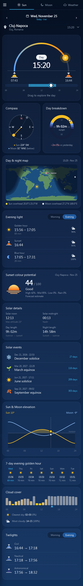
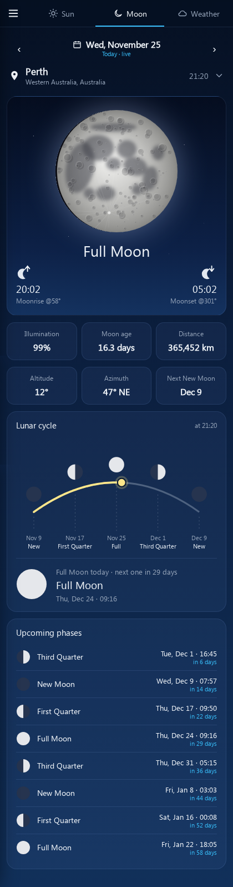
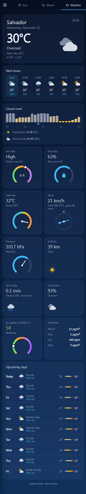
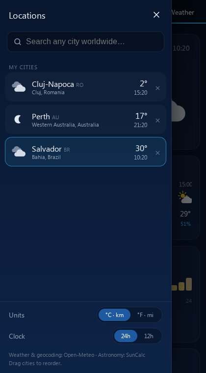
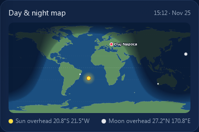

# Time.N.Weather — Dashboard Wiki

A global time, sun, moon and weather dashboard for any city on Earth. Built for the **Vivaldi Browser Side Panel** and the Vivaldi Community, and works as a standalone page in any modern desktop or mobile browser.

**Repository:** [github.com/ggr03/Time.N.Weather-Dashboard](https://github.com/ggr03/Time.N.Weather-Dashboard)
**Current version:** 2.1 (2026-11-25)

  
  &nbsp;
  
  &nbsp;
  

Sun tab (Cluj-Napoca, Romania) · Moon tab (Perth, Australia) · Weather tab (Salvador, Brazil)

---

## Table of Contents

1. [What's New in 2.x](#1-whats-new-in-2x)
2. [Managing Your Cities](#2-managing-your-cities)
3. [The Sun Tab](#3-the-sun-tab)
4. [The Moon Tab](#4-the-moon-tab)
5. [The Weather Tab](#5-the-weather-tab)
6. [Settings: Units & Clock](#6-settings-units--clock)
7. [Mobile & Cross-Browser Support](#7-mobile--cross-browser-support)
8. [Data Persistence](#8-data-persistence)
9. [Security & Integrity](#9-security--integrity)
10. [Troubleshooting](#10-troubleshooting)
11. [Credits & License](#11-credits--license)

---

## 1. What's New in 2.x

### 2.1

- **Day & night world map** on the Sun tab: a live map showing where it is day, twilight and night across the globe, where the sun and moon are directly overhead, and all your saved cities. It follows the time scrubber, so you can watch the night side move across the world.

### 2.0

Version 2.0 is a full redesign of the layout. The data sources (Open-Meteo and SunCalc) and the security model are unchanged.

- **Three tabs — Sun, Moon, Weather** — replace the old Current / Hourly / Daily / Astro views.
- **Hamburger (☰) city menu** replaces the sidebar of city tabs. Search, add, switch, reorder and remove cities from one slide-out panel.
- **Interactive sun path** with a 24-hour time scrubber: drag to see where the sun and moon are at any moment of the day.
- **Date navigation** on the Sun and Moon tabs: step to any day up to a year ahead or back.
- **New Sun data:** compass, day-breakdown ring, sunset/sunrise colour potential, solar events (solstices & equinoxes), sun & moon elevation chart, 7-day golden hour, hourly cloud cover.
- **New Moon view:** rendered moon showing the actual phase, moonrise/moonset with direction, lunar-cycle timeline, traditional full moon names, and upcoming phases.
- **New Weather view:** hero card, scrollable next-hours strip, SVG gauges (UV, humidity, feels like, wind, pressure, AQI), and a 10-day forecast with temperature range bars.
- **°C/°F and 24h/12h settings** instead of showing both units everywhere.
- **Your saved cities carry over** from version 1.x automatically.

---

## 2. Managing Your Cities

The dashboard tracks multiple locations worldwide, each with its own local timezone. Everything is stored in your browser — there's no account and no server-side sync.

### Opening the City Menu

Tap the **☰ hamburger icon** at the top-left, or tap the **city name** under the date on the Sun and Moon tabs. A panel slides in from the left. Close it with the **✕**, by tapping outside it, or by pressing `Esc`.

### Adding a New City

1. Type a city name in the search box at the top of the menu (at least 2 characters).
2. Matches from the global geocoding database appear below, showing the city plus region and country, so you can tell apart places that share a name (e.g., *London, England* vs. *London, Ontario, Canada*).
3. Tap a match — or press `Enter` to pick the first one. The city is added and becomes the active city.

> **Tip:** Adding a city that's already in your list simply switches to it instead of creating a duplicate.

### Switching Cities

Each saved city shows its current weather icon, temperature and live local time. Tap a city to switch to it; the active city is highlighted.

### Rearranging Cities

Drag a city up or down the list and drop it into place. A highlighted border shows where it will land. The new order is saved automatically.

### Removing a City

Tap the **×** on the right of a city. It is removed immediately (no confirmation prompt).

---

## 3. The Sun Tab

All sun data is calculated for the selected city's exact latitude, longitude and local day.

### Date & Time

- **‹ / ›** step to the previous or next day. The centre date button returns you to **today, live**.
- The **sun-path arc** shows sunrise (left), sunset (right) and the sun's current position, with a label for the current light phase: *Day*, *Golden hour*, *Blue hour*, *Nautical/Astro twilight* or *Night*.
- The **dotted 24-hour bar** under the arc is a time scrubber. Drag it to explore any time of the day; the arc, compass, day ring and elevation chart all follow. Tap **Now** to return to live time.

### Cards

- **Day & night map:** A world map with the night side shaded, fading through civil, nautical and astronomical twilight into full night. The yellow dot marks where the sun is directly overhead (the subsolar point) and the white dot where the moon is overhead; the coordinates of both are shown below the map. The active city is marked in red and labelled, and your other saved cities appear as small white dots. The map follows the date navigation and the time scrubber.
- **Compass:** Compass bearing of the sun (yellow) and moon (grey). Faded markers mean the body is below the horizon.
- **Day breakdown:** A 24-hour ring (midnight at the bottom, noon at the top) showing night, astronomical, nautical and civil twilight, and daylight. The centre shows total daylight and the change versus yesterday.
- **Morning / Evening light:** Toggle between morning and evening to see **Golden hour**, **Sunrise/Sunset** and **Blue hour** times, each with the forecast cloud cover at that hour.
- **Sunset (or Sunrise) colour potential:** A 0–100 estimate of how colourful the sky may be. Mid- and high-level cloud gives colour something to light up; low cloud and rain block it; a perfectly clear sky is pleasant but plain. This is a heuristic based on Open-Meteo's cloud layers, not an official forecast.
- **Solar details:** Solar noon (with the sun's maximum altitude), solar midnight (nadir), day length and night length.
- **Solar events:** The next four solstices and equinoxes, with date, local time and days left. Seasonal icons flip for the Southern Hemisphere.
- **Sun & Moon elevation:** Altitude of the sun and moon across the day, with the horizon line and a marker for the selected time.
- **7-day golden hour:** Golden hour start time and length for the next seven days (morning or evening, following the toggle).
- **Cloud cover:** Hourly cloud-cover bars for the day, with the clearest and cloudiest periods.
- **Twilights:** Civil, nautical and astronomical twilight times (morning or evening).

### Light Angle Definitions

- **Golden Hour:** Sun between -4° below and +6° above the horizon — soft, warm light.
- **Blue Hour:** Sun between -8° and -4° below the horizon — deep blue sky.
- **Civil Twilight:** Sun -6° to 0°. **Nautical Twilight:** -12° to -6°. **Astronomical Twilight:** -18° to -12°.

---

## 4. The Moon Tab

The Moon tab uses the same date navigation as the Sun tab.

- **Moon view:** A rendered moon lit to match the actual phase (mirrored for the Southern Hemisphere), with the phase name — *New Moon*, *First Quarter*, *Full Moon* and *Third Quarter* are shown on the day they occur, otherwise *Waxing/Waning Crescent/Gibbous*.
- **Moonrise / Moonset:** Local times and compass bearing (e.g., *Moonrise @55°*). On some days the moon doesn't rise or set; this is shown as *No moonrise / No moonset*.
- **Stats:** Illumination, moon age (days since the last New Moon), Earth–Moon distance, current altitude and azimuth, and the date of the next New Moon.
- **Lunar cycle:** A timeline from the last New Moon through First Quarter, Full Moon and Third Quarter to the next New Moon, with a marker for where the cycle is now.
- **Next Full Moon:** Days remaining, date and time, plus its traditional (Northern Hemisphere) name, e.g. *Full Cold Moon* in December.
- **Upcoming phases:** The next eight principal phases with date, time and days remaining.

---

## 5. The Weather Tab

- **Hero card:** City, date, live local time, current temperature, condition, feels-like temperature, and today's high and low.
- **Next hours:** A scrollable strip of the next 24 hours with icon, temperature and chance of rain.
- **Cloud cover:** Hourly cloud-cover bars for today, with the clearest and cloudiest periods.
- **Gauges & cards:**
  - **UV index:** Current UV with its category (Low → Extreme) and today's maximum.
  - **Humidity:** Relative humidity, with the dew point.
  - **Feels like:** Apparent temperature versus the actual temperature.
  - **Wind:** Speed, gusts and direction on a compass dial.
  - **Pressure:** Sea-level pressure (hPa or inHg).
  - **Visibility:** Distance, categorized as Clear, Reduced or Poor.
  - **Rain today:** Total precipitation and chance of rain.
  - **Cloudiness:** Current cloud cover.
  - **Air quality (US AQI):** Colour-coded from Good to Hazardous. Hover for a short explanation (source: AirNow.gov, U.S. EPA).
  - **Pollutants:** PM2.5, NO₂, CO₂ and dust.
- **Upcoming days:** A 10-day forecast with condition, chance of rain, and a bar showing each day's low–high range against the whole week.

Weather data is refreshed automatically every 30 minutes while the page is open. If the servers can't be reached, a **Try again** button appears.

---

## 6. Settings: Units & Clock

At the bottom of the city menu:

- **Units:** `°C · km` (metric) or `°F · mi` (imperial). Applies to temperature, wind, visibility, rain, pressure and moon distance.
- **Clock:** `24h` or `12h` time format.

---

## 7. Mobile & Cross-Browser Support

The dashboard is a single column designed for narrow side panels and phones, and is touch-friendly. It works in current versions of:

- **Desktop:** Chrome, Firefox, Vivaldi, Brave, Opera, Edge, Safari
- **Mobile:** Safari (iOS), Chrome (Android/iOS), Samsung Browser, Firefox (Android), Brave, Opera

Mobile-specific touches include safe-area padding for notches and gesture bars, no auto-zoom when typing in the search box, and home-screen support for an app-like launch icon.

---

## 8. Data Persistence

Your saved cities, their order, the active city, the last tab you used, and your units/clock settings are stored in your browser's local storage. That means:

- Your list survives closing and reopening the browser or side panel
- Data is local to that specific browser on that specific device — it does not sync across browsers or devices
- Clearing your browser's site data for this page resets everything back to defaults
- Cities saved by version 1.x are imported automatically the first time 2.0 opens

---

## 9. Security & Integrity

The dashboard is a single static HTML file with no backend server, but it still follows the same hardening practices you'd expect from a hosted app:

- **Content Security Policy (CSP):** The page restricts which scripts, styles, and network destinations it's allowed to use. Its own logic is pinned by an exact cryptographic hash — if any script content in the file changes, the browser refuses to run it until the CSP is updated to match, which prevents unexpected or injected code from executing.
- **Subresource Integrity (SRI):** The one external library the dashboard loads (SunCalc, for sun/moon calculations) is verified against a cryptographic hash before the browser will run it. If the file served from the CDN doesn't exactly match, it's blocked rather than silently executed.
- **Locked-down network access:** The dashboard can only reach the three Open-Meteo endpoints it actually needs (geocoding, weather, and air quality) — no other network destination is reachable from the page's own code.

> **Editing the file:** If you change the code inside the `<script>` block, recompute the hash as described in the comment above the CSP `<meta>` tag, or the page will load without running.

---

## 10. Troubleshooting

**The page is blank below the tabs**
The browser blocked the script — usually because the file was edited without updating the CSP hash (see above). Check the browser console for a Content Security Policy message.

**"Astronomy library unavailable" on the Sun or Moon tab**
SunCalc couldn't be loaded from cdnjs. Check your internet connection and reload.

**"Connection failed" on the Weather tab**
The dashboard couldn't reach the Open-Meteo servers. Check your connection and tap **Try again** — this is usually temporary.

**Colour potential or cloud cover says "No forecast for this date"**
Cloud data is only available from yesterday to about nine days ahead. Sun and moon times work for any date.

**No search results appear**
Type at least 2 characters and wait a moment. If nothing appears, check your connection — the search uses the live Open-Meteo geocoding service.

---

## 11. Credits & License

**Created by:** GGR, Maryland, USA
**About:** Global Time & Weather dashboard for the Vivaldi Browser Side Panel, built for the Vivaldi community.
**Inspired by:** [JRK, Sexbierum, The Netherlands](https://github.com/JRKL75/Chrono)
**Data:** Weather, air quality and geocoding by [Open-Meteo](https://open-meteo.com); sun and moon calculations by [SunCalc](https://github.com/mourner/suncalc); world map outlines from [Natural Earth](https://www.naturalearthdata.com) (public domain), embedded in the file so the map works without extra downloads.

Copyright © 2026 GGR. You are free to use, modify, share, and redistribute this project for personal or commercial purposes. Please respect the original author by keeping this notice intact and providing appropriate credit when redistributing or publishing modified versions. This project is provided "as is," without warranty of any kind — the author accepts no liability for any damages or issues arising from its use.
